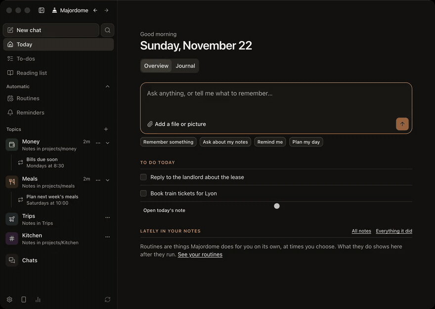
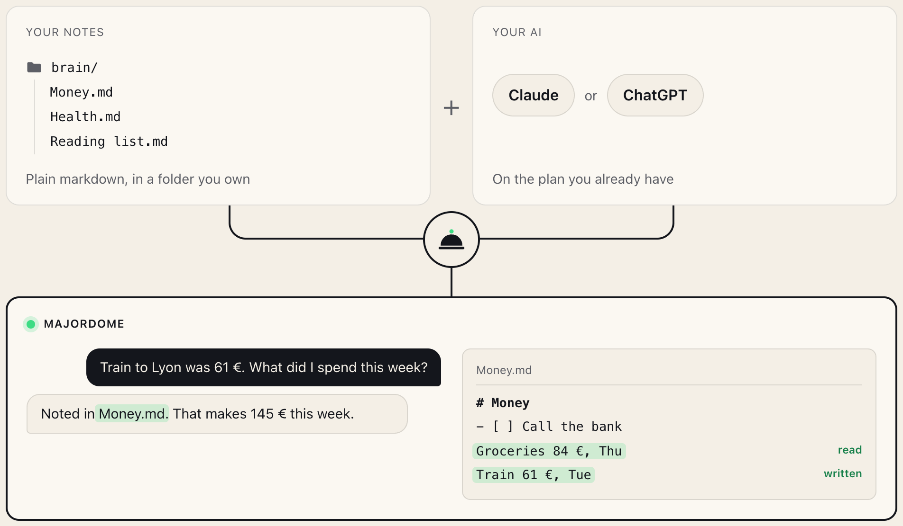
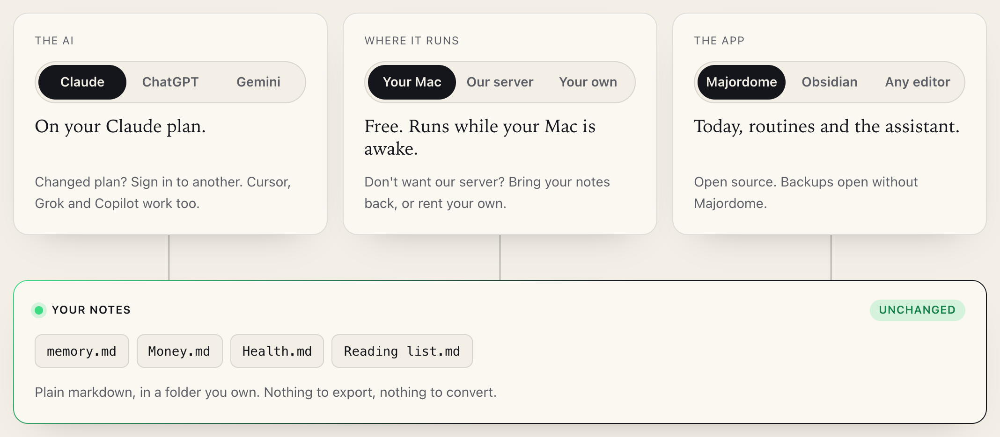
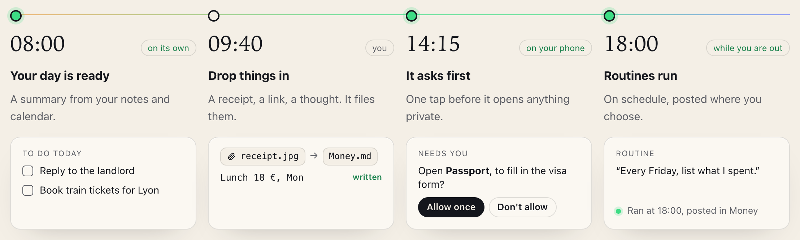
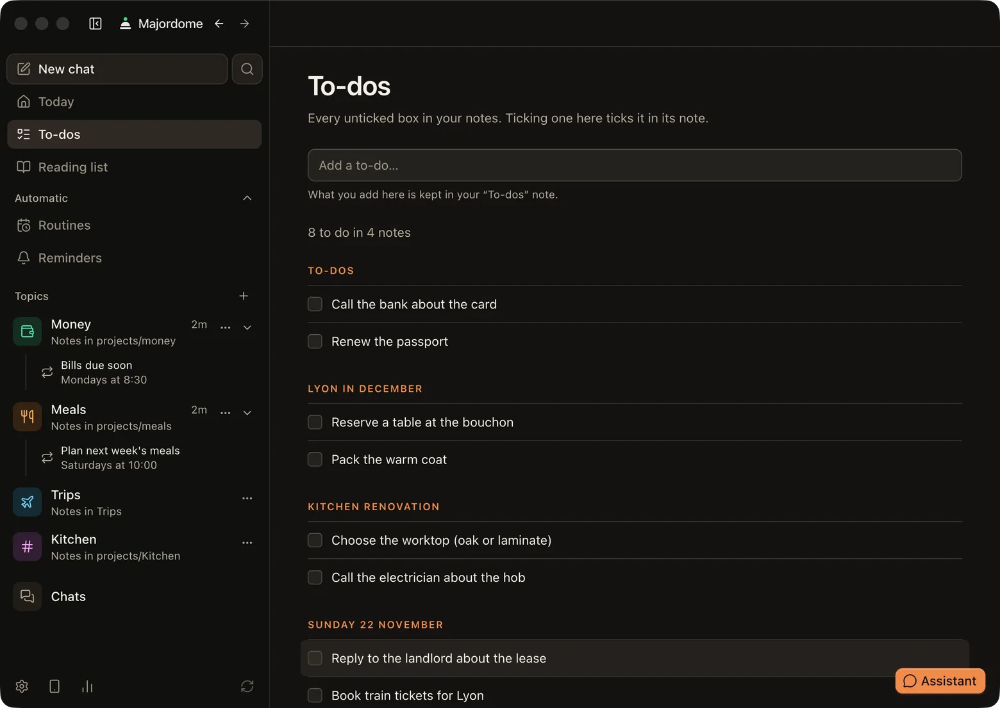
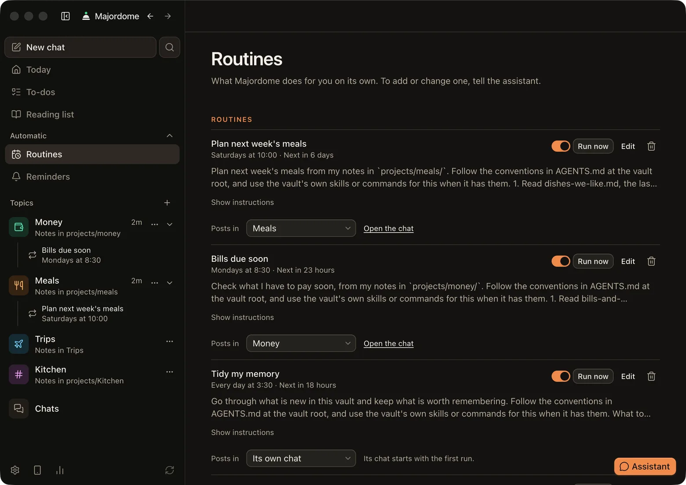
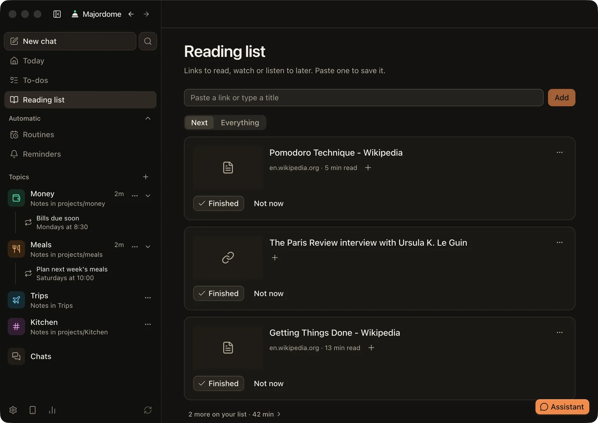
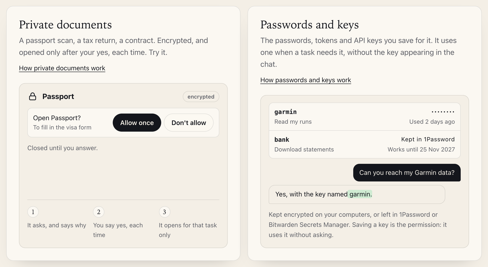
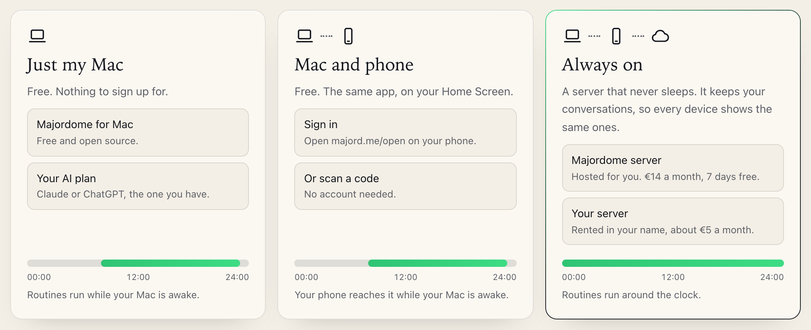

<h1 align="center">
  <picture>
    <source media="(prefers-color-scheme: dark)" srcset="assets/brand/wordmark-dark.svg">
    
  </picture>
</h1>

<p align="center">
  <b>A second brain that keeps working while you are away.</b><br>
  Your markdown notes, plus the Claude or ChatGPT plan you already pay for.
</p>

<p align="center">
  <a href="https://majord.me/download"><b>Download for Mac</b></a> ·
  <a href="https://majord.me">majord.me</a> ·
  <a href="docs/README.md">Guides</a> ·
  <a href="CHANGELOG.md">What's new</a>
</p>

<p align="center">
  <a href="https://github.com/Wozacosta/majordome/releases/latest"></a>
  <a href="LICENSE"></a>
  
</p>

<p align="center">
  <a href="https://majord.me"></a>
</p>

## Your notes, your AI, one app

<p align="center">
  <picture>
    <source media="(prefers-color-scheme: dark)" srcset="assets/readme/made-of-dark.png">
    
  </picture>
</p>

Your memory is a folder of plain markdown (an Obsidian vault works). The assistant reads it before
you type, files what you drop in, runs routines on a schedule, and asks before it touches anything
sensitive. What it learns goes into a note you can open, edit or delete.
[Try the live version](https://majord.me/#how).

## Change anything, keep your notes

<p align="center">
  <picture>
    <source media="(prefers-color-scheme: dark)" srcset="assets/readme/no-lock-in-dark.png">
    
  </picture>
</p>

No lock-in.

- **Changed AI plan?** Sign in to another. Claude, ChatGPT, Gemini (through Google's Antigravity),
  Cursor, Grok, Copilot and more: the notes are the same.
- **Don't want our server?** Bring your notes back to your computer, or
  [rent your own](docs/user/always-on-server.md) for about €5 a month.
- **Done with the app?** The notes are plain markdown: open the folder in Obsidian or any editor.
  [Backups](docs/user/backup.md) open without Majordome.

## One day with it

<p align="center">
  <picture>
    <source media="(prefers-color-scheme: dark)" srcset="assets/readme/day-dark.png">
    
  </picture>
</p>

## What it does

<table>
  <tr>
    <td width="50%" valign="top">
      <br>
      <b>Every to-do, from every note.</b><br>
      Tick one here and it is ticked in its note.
    </td>
    <td width="50%" valign="top">
      <br>
      <b>Routines, in your words.</b><br>
      Say what and when. It runs on schedule and posts where you choose.
      <a href="docs/user/routines.md">How routines work</a>
    </td>
  </tr>
  <tr>
    <td width="50%" valign="top">
      <br>
      <b>A reading list that says what is next.</b><br>
      Three things at a time. Finished, or not now.
      <a href="docs/user/reading-list.md">Reading list</a>
    </td>
    <td width="50%" valign="top">
      <br>
      <b>A topic for each part of life.</b><br>
      Money, Meals, Trips: one chat, its notes, its routines.
    </td>
  </tr>
</table>

## Private files and passwords, kept locked

<p align="center">
  <picture>
    <source media="(prefers-color-scheme: dark)" srcset="assets/readme/locked-dark.png">
    
  </picture>
</p>

- **[Private documents](docs/user/private-documents.md).** A passport scan, a tax return, a
  contract. Encrypted, and opened only after your yes, each time.
- **[Passwords and keys](docs/user/secrets.md).** The passwords, tokens and API keys you save for
  it. It uses one when a task needs it, without the key appearing in the chat. A key can stay in
  1Password or Bitwarden Secrets Manager.

And when you want them:

|                                                           |                                                                    |
| --------------------------------------------------------- | ------------------------------------------------------------------ |
| **[On your phone](docs/user/phone-and-notifications.md)** | The same app on your Home Screen. Sign in, with no code to scan.   |
| **[Always on](docs/user/always-on-server.md)**            | A small server of your own, so routines run while your Mac sleeps. |
| **[Memory](docs/user/memory.md)**                         | A memory note it reads at the start of every conversation.         |
| **[Skills](docs/user/skills.md)**                         | Your ways of doing a job, written down, that it follows by name.   |
| **[Notes search](docs/user/notes-search.md)**             | It looks inside every note, not only at file names.                |

## Pick your setup

<p align="center">
  <picture>
    <source media="(prefers-color-scheme: dark)" srcset="assets/readme/setups-dark.png">
    
  </picture>
</p>

Start on your Mac and add the rest later, without starting over. It runs on your machines and needs
no account; an optional one lets a new device find your servers when you sign in.

## What it adds to T3 Code

[T3 Code](https://github.com/pingdotgg/t3code) runs coding agents on your projects. Majordome
points the same engine at your notes.

|                   | T3 Code                                  | Majordome                                          |
| ----------------- | ---------------------------------------- | -------------------------------------------------- |
| Made for          | Developers running coding agents         | Anyone, for notes and everyday life                |
| You work in       | Projects: folders of code                | One folder of Markdown notes, split into topics    |
| The sidebar lists | Projects and their threads               | Today, To-dos, Reading list, Routines, your topics |
| What it remembers | Each thread's history                    | Your notes, and a memory note it reads every time  |
| Words on screen   | Git, pull requests, terminals, worktrees | History, Undo this, Back up, Your phone            |
| On your phone     | T3's phone apps, via T3 Connect          | The same app on your Home Screen                   |

Majordome's own: Today, To-dos, Reading list, Topics, Key facts, a map of what the assistant has, routines in your words, an undo for
what the assistant did, skills the
assistant writes for itself, private documents, passwords and keys, backup and restore, a phone with nothing to install,
a spoken conversation with a free voice on the iPhone, and a server of your own set up for you. Coding stays in T3 Code.
**[The full list](docs/vs-t3-code.md)**

## Install

Majordome runs on a Mac.

1. **[Download](https://majord.me/download)** the app, for Macs with Apple silicon.
2. **Drag** Majordome to Applications and open it.
3. **Sign in to Claude or ChatGPT** on the welcome screen. It installs what it needs.
4. **Choose your notes:** start new ones, or point it at a folder you already have. Majordome adds
   a few files of its own and changes nothing that is there.

Then, when you want them, each is one page in Settings:

- **Your account.** Sign in with an email or Google, and your computer joins your account.
- **Your phone.** Open [majord.me/open](https://majord.me/open) on it, sign in with the same
  account, press Open.
- **Back up my brain.** Pick a folder such as iCloud Drive and a passphrase. A copy is made every
  night.

Work in progress, updated often. Something broken?
[Report a problem](https://github.com/Wozacosta/majordome/issues).

## Build it yourself

```bash
git clone https://github.com/Wozacosta/majordome.git
cd majordome
vp i
vp run dev:desktop
```

You need [Vite+](https://viteplus.dev/guide/) for the `vp` command.
[Development guide](docs/operations/00_development.md) ·
[Design decisions](docs/decisions.md). `servo` is the repository's codename.

## Credits

Majordome is a fork of [T3 Code](https://github.com/pingdotgg/t3code) by T3 Tools Inc., used under
the [MIT License](LICENSE). The notes layout and skills come from
[obrain](packages/obrain) (`npx obrain`).
