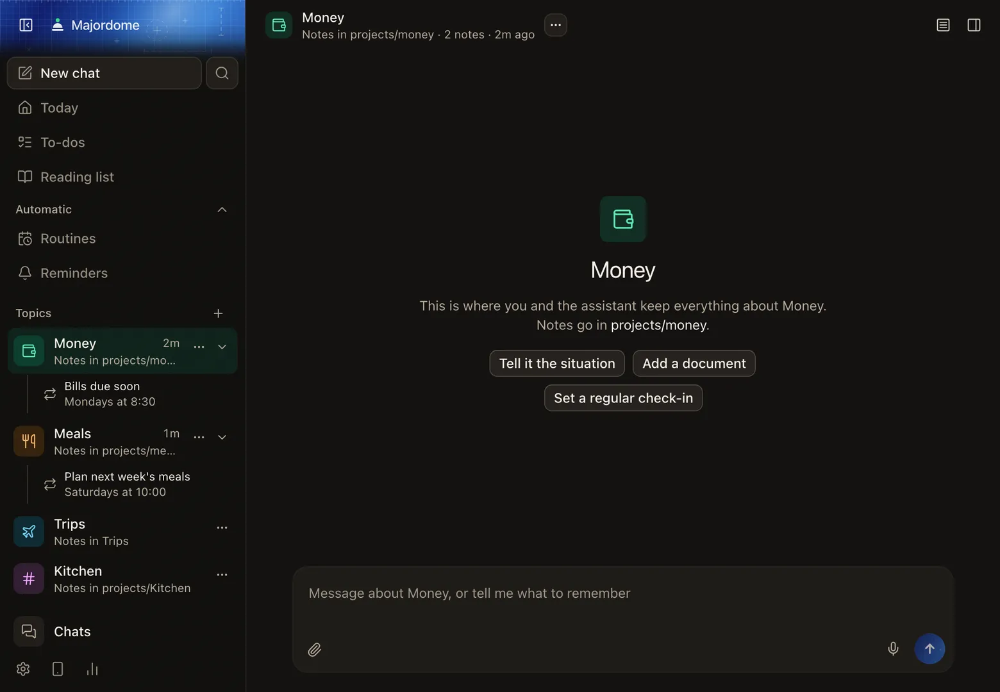

<h1 align="center">
  <picture>
    <source media="(prefers-color-scheme: dark)" srcset="assets/brand/wordmark-dark.svg">
    
  </picture>
</h1>

<p align="center">
  <b>A second brain that keeps working while you are away.</b><br>
  Your markdown notes, plus the Claude or ChatGPT plan you already pay for.
</p>

<p align="center">
  <a href="https://majord.me/download"><b>Download for Mac</b></a> ·
  <a href="https://majord.me">majord.me</a> ·
  <a href="docs/README.md">Guides</a> ·
  <a href="CHANGELOG.md">What's new</a>
</p>

<p align="center">
  <a href="https://github.com/Wozacosta/majordome/releases/latest"></a>
  <a href="LICENSE"></a>
  
</p>

<p align="center">
  <a href="https://majord.me"></a>
</p>

## What it is made of

<p align="center">
  <picture>
    <source media="(prefers-color-scheme: dark)" srcset="assets/readme/made-of-dark.png">
    
  </picture>
</p>

Your memory is a folder of plain markdown (an Obsidian vault works). The assistant reads it before
you type, files what you drop in, runs routines on a schedule, and asks before it touches anything
sensitive. There is no Majordome account and no Majordome server: it runs on your machines.

## What it does

<table>
  <tr>
    <td width="50%" valign="top">
      <br>
      <b>Every to-do, from every note.</b><br>
      Tick one here and it is ticked in its note.
    </td>
    <td width="50%" valign="top">
      <br>
      <b>Routines, in your words.</b><br>
      Say what and when. It runs on schedule and posts where you choose.
      <a href="docs/user/routines.md">How routines work</a>
    </td>
  </tr>
  <tr>
    <td width="50%" valign="top">
      <br>
      <b>A reading list that says what is next.</b><br>
      Three things at a time. Finished, or not now.
      <a href="docs/user/reading-list.md">Reading list</a>
    </td>
    <td width="50%" valign="top">
      <br>
      <b>A topic for each part of life.</b><br>
      Money, Meals, Trips: one chat, its notes, its routines.
    </td>
  </tr>
</table>

And when you want them:

|                                                           |                                                                    |
| --------------------------------------------------------- | ------------------------------------------------------------------ |
| **[On your phone](docs/user/phone-and-notifications.md)** | The same app on your Home Screen, over a private link.             |
| **[Always on](docs/user/always-on-server.md)**            | A small server of your own, so routines run while your Mac sleeps. |
| **[Private documents](docs/user/private-documents.md)**   | Encrypted. Opened only after your yes, each time.                  |
| **[Memory](docs/user/memory.md)**                         | A memory note it reads at the start of every conversation.         |
| **[Skills](docs/user/skills.md)**                         | Your ways of doing a job, written down, that it follows by name.   |
| **[Notes search](docs/user/notes-search.md)**             | It looks inside every note, not only at file names.                |

## Install

Majordome runs on a Mac.

1. **[Download](https://majord.me/download)** the app
   ([Intel Mac](https://majord.me/download/intel)).
2. **Drag** Majordome to Applications and open it.
3. **Sign in to Claude or ChatGPT** on the welcome screen. It installs what it needs.
4. **Choose your notes:** start new ones, or point it at a folder you already have. Majordome adds
   a few files of its own and changes nothing that is there.

Work in progress, updated often. Something broken?
[Report a problem](https://github.com/Wozacosta/majordome/issues).

## Build it yourself

```bash
git clone https://github.com/Wozacosta/majordome.git
cd majordome
vp i
vp run dev:desktop
```

You need [Vite+](https://viteplus.dev/guide/) for the `vp` command.
[Development guide](docs/operations/development.md) ·
[Design decisions](docs/decisions.md). `servo` is the repository's codename.

## Credits

Majordome is a fork of [T3 Code](https://github.com/pingdotgg/t3code) by T3 Tools Inc., used under
the [MIT License](LICENSE). The notes layout and skills come from
[obrain](packages/obrain) (`npx obrain`).
