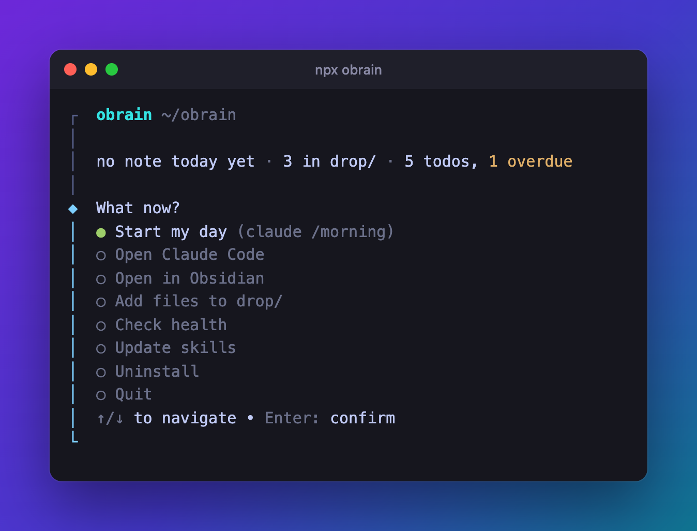
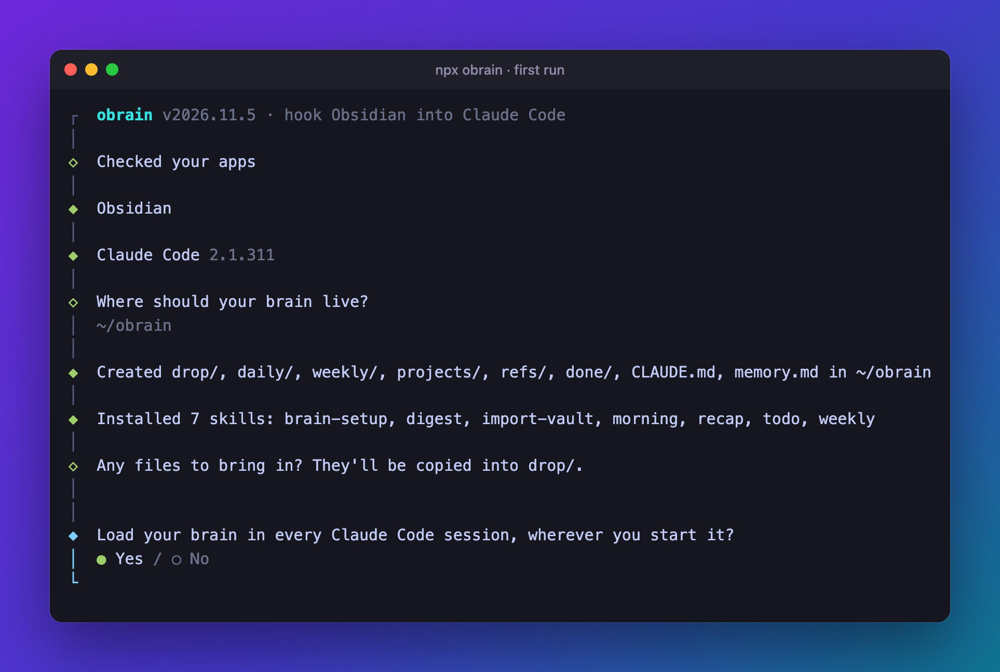
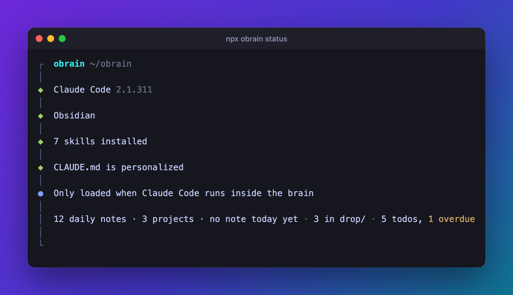

<div align="center">

# obrain

**Stop re-explaining yourself to AI every session.**

obrain wires [Obsidian](https://obsidian.md) into your AI agent: [Claude Code](https://claude.ai/code),
[Codex](https://github.com/openai/codex), Cursor, OpenCode or Gemini CLI. Your notes, files and
projects live in one folder, and the agent reads it before you type a word.

It's also the brain behind Majordome, the T3 Code fork that runs your day from that same vault.

[](https://www.npmjs.com/package/obrain)




</div>

```bash
npx obrain
```

## Why

Every new agent session starts from zero. You explain your projects again, paste the same
context again, and lose whatever you figured out last time.

obrain gives your agent a memory you own: a plain Obsidian vault of markdown files on your disk.
You write daily notes and drop in files; the agent reads them at the start of each session, files
new things where they belong, and keeps a log of how you work. The more you use it, the less you
explain. Switch from Claude Code to Codex tomorrow and the brain comes with you.

- **Local.** Markdown files in a folder. No server, no account, no API keys, nothing phones home.
- **Yours.** It's an ordinary Obsidian vault. Stop using obrain and your notes stay put.
- **Small.** One dependency, a few skills, and a menu for the everyday bits.
- **Any agent.** One `AGENTS.md` and one `.agents/skills/` folder, read by every agent that
  supports them.

## Get started

```bash
npx obrain
```

The first run is a short wizard. It checks for Obsidian and an AI agent CLI (and offers to install
Obsidian, and Claude Code or Codex if you have no agent yet), asks where your brain should live,
builds it, and opens it in Obsidian.

<p align="center">
  
</p>

Then open your agent in the brain and run **`/brain-setup`** (in Codex, `$brain-setup`; anywhere,
"set up my brain" works). The agent asks two questions about how you work and tailors the
folders, the skills and `AGENTS.md` to you.

**Already have a vault?** Point the wizard at it. It adds what's missing and leaves your notes
alone. A `CLAUDE.md` you wrote moves into `AGENTS.md`, so every agent reads it; the original is
kept as `CLAUDE.md.bak-<timestamp>`. An existing `AGENTS.md` stays as it is.

## Every day

Run `npx obrain` again and you get the menu above: what's waiting for you, and one keypress to
start the day. **Start my day** opens your agent in your brain on the `morning` skill, which
creates today's note, reads anything new in `drop/` and flags overdue todos.

obrain opens whichever agent CLI you have: `claude`, `codex`, `cursor-agent`, `opencode` or
`gemini`. With more than one, it asks once and remembers; **Switch agent** in the menu, or
`npx obrain agent codex`, changes it.

Every menu item is also a command:

| Command | What it does |
| --- | --- |
| `npx obrain morning` | Open your agent in your brain and run `morning` |
| `npx obrain start` | Open your agent in your brain |
| `npx obrain agent [name]` | Pick the agent obrain opens: `claude`, `codex`, `cursor`, `opencode`, `gemini` |
| `npx obrain open` | Open your brain in Obsidian |
| `npx obrain drop <files...>` | Copy files or folders into `drop/` |
| `npx obrain status` | Health check: apps, skills, today's note, todos |
| `npx obrain update` | Update the skills and the layout, keeping anything you've edited |
| `npx obrain uninstall` | Remove obrain, keep your notes |

Add `--yes` to skip every question (handy in scripts) and `--no-install` to never install apps.
`npm i -g obrain` drops the `npx`.

<p align="center">
  
</p>

## Inside your agent

| Skill | What it does |
| --- | --- |
| `/brain-setup` | One-time setup. Asks about your work and builds a tailored brain. |
| `/morning` | Start of day. Opens today's note, checks what's new, asks what to focus on. |
| `/weekly` | End of week. Reviews the daily notes, finds patterns, plans next week. |
| `/recap` | End of session. Captures what happened and files it. |
| `/todo` | Task list in `todo.md`: add, finish, reprioritize. |
| `/digest` | Reads a folder of files (PDFs, docs, images) and writes markdown summaries. |
| `/import-vault` | Pulls notes from another Obsidian vault into this brain. |

Type them as `/name` in Claude Code or `$name` in Codex, or don't type them at all: the agent
picks the right one when you say "start my day", "add a todo" or "save this session".

The skills live in your brain's `.agents/skills/`, where Codex, Cursor, OpenCode and Gemini CLI
find them; `.claude/skills` is a symlink to it for Claude Code. That way `/brain-setup` tailors
one copy to your folders. During setup you can also have your agents load your brain in every
session, wherever you start them: obrain adds a short `## obrain` block to the global
instructions of each agent you've set up (`~/.claude/CLAUDE.md`, `~/.codex/AGENTS.md`,
`~/.config/opencode/AGENTS.md`, `~/.gemini/GEMINI.md`). Cursor keeps its global rules in its
settings, so there it loads only inside the brain.

## Bring in your files

PDFs, Word docs, slides, screenshots: copy them into `drop/` and your agent reads them natively.

```bash
npx obrain drop ~/Downloads/receipts ~/Desktop/whiteboard.jpg
```

Then tell your agent: *"digest and sort drop/"*.

## What's in a brain

```
~/obrain/
├── AGENTS.md         who you are and how the brain works — loaded every session, by every agent
├── CLAUDE.md         one line, @AGENTS.md, so Claude Code loads it too (and GEMINI.md for Gemini CLI)
├── memory.md         what your agent has learned about how you work
├── todo.md           one task list
├── drop/             incoming files and ideas
├── daily/            one note per day
├── weekly/           weekly reviews
├── projects/         active work, one folder each
├── refs/             reference material
├── done/             finished work; nothing gets deleted
├── .agents/skills/   the skills, shared by every agent (.claude/skills links here)
└── .majordome/       settings for Majordome: where memory.md and daily notes live
```

`/brain-setup` adds folders that fit you: `people/` and `decisions/` if you run things,
`clients/` if you advise, `courses/` if you're learning.

## Requirements

- macOS or Linux, with Node.js 20.12 or newer
- [Obsidian](https://obsidian.md) (free). The wizard installs it if it's missing: Homebrew on
  macOS, Flatpak on Linux.
- At least one agent CLI: [Claude Code](https://claude.ai/code), [Codex](https://github.com/openai/codex),
  [Cursor CLI](https://cursor.com/cli), [OpenCode](https://opencode.ai) or
  [Gemini CLI](https://geminicli.com). With none, the wizard offers to install Claude Code or Codex.

## Uninstall

```bash
npx obrain uninstall
```

This removes the skills and their `.claude/skills` link, the template `AGENTS.md` with the
`CLAUDE.md`/`GEMINI.md` lines that import it, every `## obrain` block in your agents' global
instructions and obrain's config. Your notes, `todo.md`, `memory.md`, your own skills, a
personalized `AGENTS.md` and `.majordome/` stay, and so do Obsidian and your agents.

## Development

```bash
git clone https://github.com/wozacosta/obrain.git && cd obrain
npm install
npm test             # node:test, no extra tooling
node bin/obrain.js   # run the CLI from the checkout
```

`./setup.sh` and `./uninstall.sh` still work for a clone; they call the same CLI.

## License

[The obrain License](LICENSE): MIT with personality.
